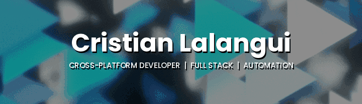

  

  

  [About me](#-about-me) •
  [Professional profile](#-professional-profile) •
  [Experience](#-experience) •
  [Tech stack](#-tech-stack) •
  [Contact](#-contact)

---

## 🔳 About me

Hi! I'm **Cristian Lalangui**, a Higher Technician in Cross-Platform Application Development (DAM) and a **Full Stack** developer passionate about technology and about building software that works well and is easy to maintain.

I'm comfortable working on both **backend** (Django, Flask, Java Spring Boot) and **frontend and mobile** (Angular, Android Studio), paying close attention to project structure, code quality and user experience.

I have hands-on experience in **process automation with n8n**, **API integration** and designing **MCP (Model Context Protocol) architectures** for AI systems.

I'm currently studying a **Bachelor's Degree in Computer Engineering** at Universidad Europea de Madrid, and I'm looking for my first job as a developer, on a team where I can contribute from day one and keep growing.

I'm defined by curiosity, responsibility, teamwork and a drive for continuous learning.

  
  
  

---

## 🔳 Professional profile

<table>
<tr>
<td width="50%" valign="top">

<h3>
  
  Backend development
</h3>

REST APIs and business logic with **Django, Flask and Java Spring Boot**, backed by **PostgreSQL and MySQL** databases.

</td>
<td width="50%" valign="top">

<h3>
  
  Frontend development
</h3>

Modern, responsive interfaces built with **Angular, HTML and CSS/SCSS**, focused on a clear user experience.

</td>
</tr>

<tr>
<td width="50%" valign="top">

<h3>
  
  Mobile apps
</h3>

**Android** application development with Android Studio.

</td>
<td width="50%" valign="top">

<h3>
  
  Automation & AI
</h3>

**No-code/low-code workflows with n8n** and design of **MCP architectures** and integration systems for AI.

</td>
</tr>

<tr>
<td width="50%" valign="top">

<h3>
  
  Code & architecture
</h3>

Scalable, efficient and well-structured solutions, with separation of concerns and reusable components.

</td>
<td width="50%" valign="top">

<h3>
  
  Teamwork
</h3>

**Git and GitHub** for collaboration through branches, commits and pull requests, with clear communication within the team.

</td>
</tr>
</table>

  
  
  
  
  

---

## 🔳 Experience

**Backend & Automation Developer** · *Lobbes Marketplace* · Mar 2026 – Jun 2026

- Managed automations and built no-code/low-code workflows with **n8n**.
- Designed an **MCP (Model Context Protocol) architecture** and integration systems for AI.
- Integrated **APIs** and developed backend systems with **Django and Flask**.
- Built web pages with **HTML and CSS**.

**Education**

- 🎓 Bachelor's Degree in Computer Engineering, Universidad Europea de Madrid (2026 – 2030, in progress)
- 🎓 Higher Technician in Cross-Platform Application Development (DAM), Epsum – FP Euroformac (2024 – 2026)

---

## 🔳 Tech stack

### Backend & databases

  
  
  
  
  

### Frontend & mobile

  
  
  
  
  

### Languages

  
  
  
  

### Automation & tools

  
  
  

  
  
  
  
  

---

## 🔳 Professional interests

- 📱 Web and mobile application development
- 🏗️ Software architecture
- 🔌 REST APIs and systems integration
- 🤖 Automation and AI (n8n, MCP)
- ⚡ Optimization and scalability
- 📚 Continuous learning and new technologies

---

## 🔳 Contact

  
  

  
<i>📍 Madrid, Spain · Available for immediate start</i>

